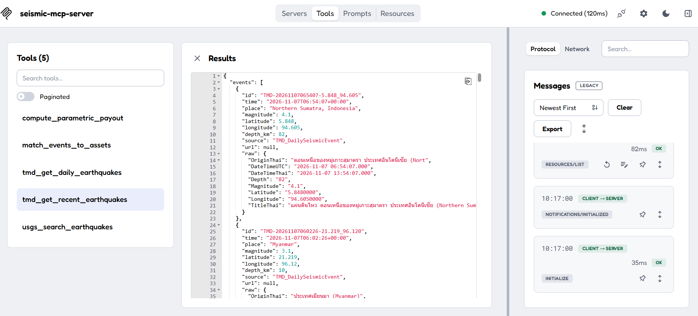

# Seismic MCP Server (Streamable HTTP)

MCP server สำหรับข้อมูลแผ่นดินไหวและ analytics ด้านประกันภัย (parametric)
ดึงข้อมูลจาก USGS FDSN API และ TMD DailySeismicEvent (demo key) แล้ว normalize เป็น `EarthquakeEvent`

- Transport: **Streamable HTTP** ที่ `http://localhost:8000/mcp`
- รุ่นนี้ส่งมอบผ่าน Streamable HTTP ตามขั้นตอนเชื่อมต่อ client ด้านล่าง
- Health check: `http://localhost:8000/health`
- Stateless (ไม่มี session ฝั่ง server) เหมาะกับ container

## Tools

| Tool | หน้าที่ |
|---|---|
| `usgs_search_earthquakes` | ค้นหาแผ่นดินไหวจาก USGS (ช่วงเวลา, magnitude, รัศมี, limit) |
| `tmd_get_daily_earthquakes` | แผ่นดินไหวรายวันจาก TMD |
| `tmd_get_recent_earthquakes` | TMD ย้อนหลัง N วัน (1-7) de-duplicate และเรียงเวลาล่าสุดก่อน |
| `match_events_to_assets` | จับคู่เหตุการณ์กับทรัพย์สินที่เอาประกันตามระยะทาง (haversine) และ magnitude |
| `compute_parametric_payout` | คำนวณ payout ตาม magnitude trigger, ระยะทาง และ payout curve |

## ตัวอย่างการใช้งาน

ภาพจาก MCP Inspector หลังเชื่อมต่อผ่าน Streamable HTTP และเรียก `tmd_get_recent_earthquakes` สำเร็จ



ผลจาก `compute_parametric_payout` เป็นตัวอย่างการคำนวณตามเกณฑ์ที่กำหนดในคำขอ

## รันด้วย Docker

```bash
docker compose up -d --build
curl http://localhost:8000/health
docker compose logs -f
docker compose down
```

หรือไม่ใช้ compose:

```bash
docker build -t seismic-mcp-server:0.1.0 .
docker run -d --name seismic-mcp -p 127.0.0.1:8000:8000 seismic-mcp-server:0.1.0
```

> พอร์ตถูกผูกกับ `127.0.0.1` เท่านั้น เพราะ server ไม่มี authentication
> ถ้าจะเปิดออกนอกเครื่อง ให้ใส่ reverse proxy + auth + HTTPS ก่อน

## รันโดยไม่ใช้ Docker

```bash
pip install -r requirements.txt
python server.py
```

## ตัวแปรสภาพแวดล้อม

หากใช้ Docker Compose และมีคีย์ TMD ของตัวเอง ให้คัดลอก `.env.example` เป็น `.env` แล้วตั้งค่า `TMD_UID` และ `TMD_UKEY` ก่อนเริ่ม container

| ตัวแปร | ค่าเริ่มต้น | ความหมาย |
|---|---|---|
| `MCP_HOST` | `0.0.0.0` | address ที่ bind |
| `MCP_PORT` | `8000` | พอร์ต |
| `TZ` | `Asia/Bangkok` | ใช้หา "วันนี้" ของ TMD |
| `TMD_UID` / `TMD_UKEY` | `api` / `api12345` | demo credentials |
| `HTTP_TIMEOUT` | `20` | timeout เรียก API ภายนอก (วินาที) |
| `LOG_LEVEL` | `INFO` | log ไป stderr |

## เชื่อมต่อ client

**MCP Inspector**

```bash
npx @modelcontextprotocol/inspector
# Transport: Streamable HTTP, URL: http://localhost:8000/mcp
```

**Claude Code**

```bash
claude mcp add --transport http seismic http://localhost:8000/mcp
```

**Claude Desktop** (config แบบ `mcpServers` รองรับเฉพาะ stdio จึงต้องใช้ตัวแปลง `mcp-remote`)

```json
{
  "mcpServers": {
    "seismic-mcp-http": {
      "command": "npx",
      "args": ["-y", "mcp-remote", "http://localhost:8000/mcp", "--allow-http"]
    }
  }
}
```

## ทดสอบ

```bash
pip install -r requirements.txt
python test_client.py                                   # offline ใช้ข้อมูลจำลอง
python test_client.py --live http://localhost:8000/mcp  # ยิง API จริงผ่าน server ที่รันอยู่
```

## หมายเหตุ

- Error (input ไม่ถูกต้อง, upstream ล่ม) ส่งกลับเป็น tool result ที่ `isError: true` ตามแนวทางของ MCP
  ไม่ใช่ JSON-RPC error เพื่อให้ LLM เห็นข้อความแล้วแก้ไขเองได้
- `tmd_get_recent_earthquakes` ถ้าบางวันดึงไม่สำเร็จจะยังคืนวันที่เหลือ และเพิ่ม key `warnings`
  จะ error ก็ต่อเมื่อล้มทุกวัน
- TMD ที่ส่งรายการเหตุการณ์ว่างถือว่าสำเร็จ ส่วน payload ที่ไม่มีรายการเหตุการณ์ตามรูปแบบที่รองรับจะถือเป็น upstream error
- `compute_parametric_payout` ใช้ curve เริ่มต้นเมื่อไม่ส่ง `payout_curve` หรือส่ง `null`
  ถ้าระบุ curve ต้องมีอย่างน้อยหนึ่งขั้น หากต้องการกำหนดยอดจ่ายเป็นศูนย์ให้ใช้ `payout_percent: 0`
- โครงสร้างจริงของ TMD ต่างจาก spec: รายการอยู่ใต้ key `DailyEarthquakes` (ไม่ใช่ `DailySeismicEvent`),
  ค่าตัวเลขเป็น string, ไม่มี `EventID` และชื่อสถานที่เป็นภาษาไทยที่มีชื่ออังกฤษในวงเล็บท้ายข้อความ
  server จึงสร้าง `id` เองเป็น `TMD-<เวลา UTC>-<lat>_<lon>`, ใช้ชื่ออังกฤษในวงเล็บเป็น `place`
  (ข้อความไทยเดิมอยู่ใน `raw.TitleThai`) และยังรองรับโครงสร้างแบบใน spec ด้วย
- API ของ TMD ครอบคลุมเหตุการณ์ในภูมิภาคและทั่วโลก ไม่ใช่เฉพาะในไทย
